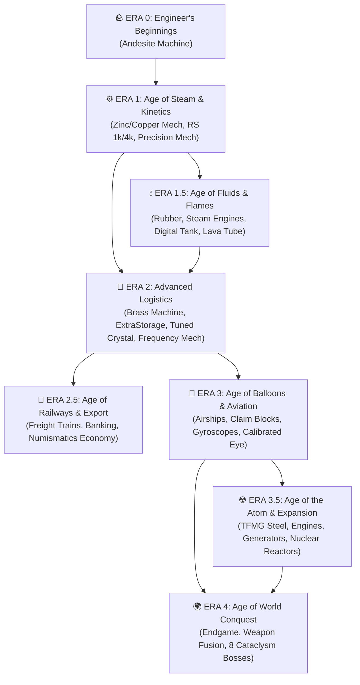

# 🚂 AeroStratum: Integrated Engineering

**[ 🇬🇧 English Version (Active) ](./README.md)** | **[ 🇵🇱 Wersja Polska (README.pl.md) ](./README.pl.md)**

Welcome to **AeroStratum: Integrated Engineering** — a **NeoForge 1.21.1** modpack built upon a strict **Era-Based Progression System**. Progress through core technological milestones and unlock specialized sub-eras on your journey from basic kinetic hand-cranks to freight rail empires, flying dreadnoughts, nuclear reactors, and god-slaying encounters.

---

## 🗺️ Progression Flowchart (Core Eras & Sub-Eras)

---

## 📜 The Progression Roadmap (Core Eras & Sub-Eras)

Progression is strictly tied to custom **KubeJS** recipes, game stages, and **FTB Quests** Milestones (fully localized in **English** and **Polish**). Complete each core era's main milestone to unlock the next technological age, while specialized sub-eras branch off to expand your industrial arsenal!

* **🪨 Era 0: Engineer's Beginnings (Andesite Foundation)**
  * Gear up with *Sophisticated Backpacks*, secure your territory, and master basic metallurgy and *Andesite Alloys*. Build your first kinetic components to assemble the **Andesite Machine** — the milestone key to Era 1!
* **⚙️ Era 1: Age of Steam & Kinetics**
  * Automate sheet rolling, deploy infinite geological **Mechanical Extruders**, and assemble *Zinc* and *Copper Mechanisms* on your way to the **Precision Mechanism** milestone.
  * 💡 **Early Digital Storage:** Unlock **Refined Storage** (1k/4k drives via custom *Digital Drawers*) and *Functional Storage* early to eliminate chest chaos! Basic digital storage is accessible right away, while high-capacity drives and full autocrafting remain gated behind future eras.
  * 💧 **Sub-Era 1.5: Age of Fluids & Flames** — Branch into copper hydraulics, vulcanized rubber, liquid-fueled *Blaze Burners*, high-output **Steam Engines**, digitized fluid storage (*Digital Tanks*), and thermal **Lava Tubes**.
* **🧠 Era 2: Age of Advanced Logistics**
  * Step into **Brass Machines**, **Brass Redstone Machines**, **Mechanical Crafters**, **Crushing Wheels**, and **Brass Extruders**. Scale up to 16k/64k drives, deploy tiered *ExtraStorage* **Autocrafters** (up to Netherite), cultivate amethyst geodes, and calibrate **Tuned Crystals** into the **Frequency Mechanism**.
  * 🚂 **Sub-Era 2.5: Age of Rails & Wholesale Export** — Construct long-distance train networks with *Create* and *Steam 'n' Rails*! Export mass-produced goods straight to the **Pre-built Central Spawn Hub** or player-run **Vendors**, backed by **Bank Terminals** and cashless **Bank Cards** (*Create: Numismatics*).
* **🎈 Era 3: Age of Balloons & Aeronautics**
  * Take your factory into the skies using **Create Aeronautics** & **Create Simulated**. Build functional balloons, airships, and mobile airborne bases protected by **Contraption Claim Blocks**, wireless telemetry, and docking stations. Master **Gyroscopic Mechanisms** and precision navigation instruments to craft the **Calibrated Eye** and unlock the gateway to The End.
  * ⚛️ **Sub-Era 3.5: Age of the Atom & Mass Expansion** — Enter heavy industry! Smelt industrial steel and automate **Steel Mechanisms** (*Create: The Factory Must Grow*), run combustion engines and high-voltage electrical generators, and construct nuclear reactors (**Create Nuclear**) to power vast industrial grids.
* **🌍 Era 4: Age of World Conquest (Endgame)**
  * The ultimate test. Combine your industrial titan-complex, maxed-out digital logistics, foundry-cast **Silent Gear** equipment, and *Pinnacle*-tier **Apotheosis** infusions to conquer all 8 ancient bosses from **L_Ender's Cataclysm** and forge hybrid weapons on the **Mechanical Fusion Anvil**.

---

## 💎 Key Features Included

* **🔧 Zero-RNG Deterministic Assembly & Custom Integration:** Say goodbye to losing resources on 90% roll chances! Every *Sequenced Assembly* line—including *Gyroscopic* and *Steel Mechanisms*—is engineered for **100% reliability**, linking *Create*, *Refined Storage*, *ExtraStorage*, *TFMG*, and *Create Nuclear* through custom mechanisms and reusable calibration tools.
* **🔥 Multiblock Foundry Metallurgy:** Paper blueprints are history. **Silent Gear** is seamlessly integrated with **Productive Metalworks** foundries—smelt alloys, pour molten steel into reusable casts, grade materials, and empower gear under the **Starlight Charger**.
* **⚔️ World Tiers, Relics & Spawner Engineering:** Progress through 5 **Apotheosis** World Tiers (*Haven → Pinnacle*), hunt Mimics for **Artifacts**, level up evolving **Relics**, and engineer custom mob farms using **Apothic Spawners** and **Mob Grinding Utils**.
* **🌲 World Overhaul:** Explore a breathtaking world generated by **Terralith** and **Serene Seasons**, packed with overhauled dungeons from the complete **YUNG's Better Structures** suite.
* **🛡️ Industrial Mission Control (EN / PL):** A complete claim, team, and questing ecosystem driven by **FTB Quests** (available in English & Polish), **FTB Teams**, **FTB Chunks**, and **Contraption Claim Blocks** for skyborne vessels.
* **⚡ Server-Friendly Optimization:** Powered by **Sodium**, **FerriteCore**, **ModernFix**, and **Chunky** pre-generation to guarantee high FPS and stable server TPS even with massive automated factories.
* **🎁 Instanced Multiplayer Loot:** Built with **Lootr** and **LootJS**, ensuring every explorer on a server gets their fair share of unique rewards from bosses and structures.

---

## 🏛️ Pre-Configured World & Train Economy

This modpack features a **pre-built, custom world map** bundled directly with the modpack. Instead of generating a random survival seed, your journey begins directly at the **Central Spawn Hub** — a pre-engineered metropolis equipped with a wholesale train unloading station, banking facilities, and market stalls where **Create: Numismatics** coins are the sole accepted currency!

---

## 🛠️ Repository Structure & Installation

### Repository Layout:
* `overrides/kubejs/` – Custom KubeJS recipe scripts (including zero-RNG *Sequenced Assembly*), item registrations, and custom 3D machine models.
* `overrides/config/ftbquests/` – Complete questlines localized in both **English (`en_us.snbt`)** and **Polish (`pl_pl.snbt`)**.
* `manifest.json` & `modlist.html` – Modpack manifest files for CurseForge App and Prism Launcher.

### How to Play:
1. Download the pack via **CurseForge App** or **Prism Launcher** from the [CurseForge Project Page](https://www.curseforge.com/minecraft/modpacks/aerostratum-integrated-engineering).
2. Allocate **6 GB – 8 GB of RAM** in your launcher settings.
3. Start a new game — the bundled world map will spawn you directly inside the **Central Spawn Hub**!

---

## 💡 Inspirations & Credits

* **Inspired by:**
  * **Chosen's *Create Integrated*** — for its core philosophy of heavily integrated automated systems and localized progression loops.
  * ***ATM10: Aeronautics* (All the Mods Team)** — for inspiring many of our questline layouts, guides, and comprehensive side-chapters outside the main technological path.
* **Mod Authors & Creators:** A massive thank you to all the incredibly talented developers and quest designers across the NeoForge, Create, Simulated Team, and All the Mods ecosystems.
* **Complete Mod List & Attributions:** You can find the full manifest of included modifications in [`modlist.html`](./modlist.html) or in the official **Relations -> Dependencies** tab on [CurseForge](https://www.curseforge.com/minecraft/modpacks/aerostratum-integrated-engineering).