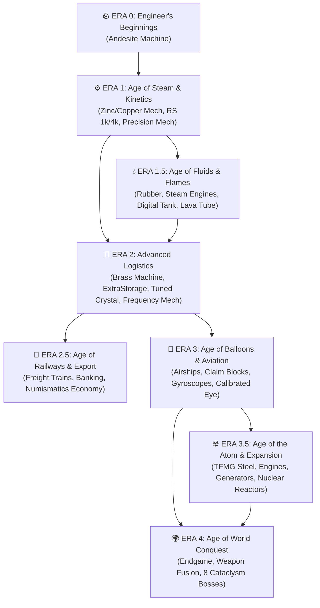

# ⚙️ AeroStratum: Integrated Engineering

**[ 🇬🇧 English Version (Active) ](./README.md)** | **[ 🇵🇱 Wersja Polska (README.pl.md) ](./README.pl.md)**

)

*An Era-based NeoForge 1.21.1 technological & RPG modpack featuring 100% deterministic Create assembly lines, early digital storage, a pre-built Central Spawn trade hub, airships, and nuclear power.*

---

## 🗺️ Progression Flowchart (Core Eras & Sub-Eras)

### Industrial Milestones:
* **🪨 Era 0 – Engineer's Beginnings:** Basic metallurgy, *Sophisticated Backpacks*, *Andesite Alloys*, and your first **Andesite Machine**.
* **⚙️ Era 1 – Age of Steam & Kinetics:** Sheet rolling, infinite geological **Mechanical Extruders**, early **Refined Storage** (1k/4k drives via *Digital Drawers*), and the **Precision Mechanism**.
  * **💧 Sub-Era 1.5 – Age of Fluids & Flames:** Copper hydraulics, vulcanized rubber, liquid-fueled *Blaze Burners*, **Steam Engines**, *Digital Tanks*, and thermal **Lava Tubes**.
* **🧠 Era 2 – Age of Advanced Logistics:** *Brass Machines*, *Brass Redstone Machines*, *Mechanical Crafters*, *Crushing Wheels*, tiered *ExtraStorage* **Autocrafters** (up to Netherite), amethyst cultivation, and the **Frequency Mechanism**.
  * **🚂 Sub-Era 2.5 – Age of Railways & Export:** Long-distance freight networks (*Create* & *Steam 'n' Rails*), wholesale export to the pre-built **Central Spawn Hub**, **Bank Terminals**, and cashless **Bank Cards** (*Create: Numismatics*).
* **🎈 Era 3 – Age of Balloons & Aviation:** Skyborne bases and airships protected by **Contraption Claim Blocks**, wireless telemetry, docking stations, **Gyroscopic Mechanisms**, and the **Calibrated Eye** unlocking The End.
  * **☢️ Sub-Era 3.5 – Age of the Atom & Mass Expansion:** Heavy steel metallurgy and **Steel Mechanisms** (*TFMG*), combustion engines, electrical generators, and nuclear reactors (*Create Nuclear*).
* **🌍 Era 4 – Age of World Conquest:** Endgame boss hunts against all 8 ancient rulers from **L_Ender's Cataclysm**, backed by foundry-cast **Silent Gear** equipment (*Productive Metalworks*) and *Pinnacle*-tier **Apotheosis** infusions.

---

## 🛠️ Repository Structure

* `overrides/kubejs/` – Custom KubeJS recipe scripts (including zero-RNG *Sequenced Assembly*), item registrations, and custom 3D machine models.
* `overrides/config/ftbquests/` – Complete questlines localized in both **English (`en_us.snbt`)** and **Polish (`pl_pl.snbt`)**.
* `manifest.json` & `modlist.html` – Modpack manifest files for CurseForge App and Prism Launcher.

---

## 💻 Installation & Requirements

1. Download the pack via **CurseForge App** or **Prism Launcher** from the [CurseForge Project Page](https://www.curseforge.com/minecraft/modpacks/aerostratum-integrated-engineering).
2. Allocate **6 GB – 8 GB of RAM** in your launcher settings.
3. Start a new game — the bundled world map will spawn you directly inside the **Central Spawn Hub**!