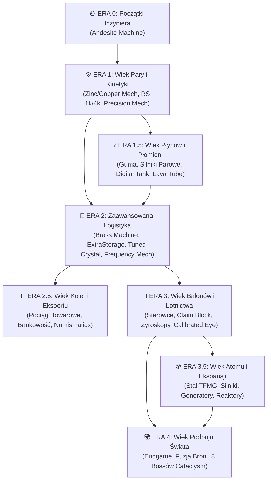

# 🚂 AeroStratum: Integrated Engineering

**[ 🇬🇧 English Version (README.md) ](./README.md)** | **[ 🇵🇱 Wersja Polska (Aktywna) ](./README.pl.md)**

Witaj w **AeroStratum: Integrated Engineering** — paczce modyfikacji na **NeoForge 1.21.1** zbudowanej wokół ścisłego **Systemu Progresji Opartego na Erach**. Przechodź przez kolejne kamienie milowe technologii i odblokowuj wyspecjalizowane sub-ery na swojej drodze od prostych korb ręcznych, przez imperia kolejowe, latające pancerniki i reaktory jądrowe, aż po starcia z pradawnymi bossami.

---

## 🗺️ Schemat Progresji (Ery Główne i Sub-Ery)

---

## 📜 Mapa Rozwoju (Ery Główne i Sub-Ery)

Progresja w paczce jest ściśle powiązana z autorskimi recepturami **KubeJS**, etapami gry (*Game Stages*) oraz kamieniami milowymi w **FTB Quests** (w pełni przetłumaczonymi na język **polski** i **angielski**). Ukończenie głównego kamienia milowego danej ery otwiera kolejny rozdział technologiczny, natomiast sub-ery pozwalają rozbudować Twój arsenał przemysłowy!

* **🪨 Era 0: Początki inżyniera (Fundament Andezytowy)**
  * Wyposaż się w plecaki *Sophisticated Backpacks*, zabezpiecz swój teren i opanuj podstawową metalurgię oraz produkcję *Andesite Alloy*. Zbuduj pierwsze komponenty kinetyczne, aby złożyć **Andesite Machine** — klucz otwierający Erę 1!
* **⚙️ Era 1: Wiek Pary i Kinetyki**
  * Zautomatyzuj walcowanie blach, zbuduj nieskończone generatory skał (**Mechanical Extruder**) i składaj mechanizmy cynkowe oraz miedziane w drodze do kamienia milowego: **Precision Mechanism**.
  * 💡 **Wczesny Magazyn Cyfrowy:** Odblokuj **Refined Storage** (dyski 1k/4k budowane z udziałem *Digital Drawer*) oraz *Functional Storage* już na wczesnym etapie, aby raz na zawsze pożegnać chaos w skrzyniach! Podstawowe dyski są dostępne od razu, natomiast ogromne nośniki danych i zaawansowany autocrafting czekają w kolejnych erach.
  * 💧 **Sub-Era 1.5: Wiek płynów i płomieni** — Opanuj miedzianą hydraulikę, wulkanizację gumy, płynne paliwa podawane Płomykom przez słomki, potężne **Silniki Parowe**, cyfrowe magazynowanie cieczy (*Digital Tank*) oraz termiczne przewody **Lava Tube**.
* **🧠 Era 2: Wiek zaawansowanej logistyki**
  * Wkraczaj w technologię **Brass Machine**, **Brass Redstone Machine**, matryc **Mechanical Crafter**, **Crushing Wheels** oraz **Brass Extruder**. Rozbuduj pamięć sieci do dysków 16k/64k, wdrażaj wieloslotowe **Autocraftery** z *ExtraStorage* (od żelaznych aż po netherytowe), hoduj geody ametystowe i kalibruj **Tuned Crystals** w **Frequency Mechanism**.
  * 🚂 **Sub-Era 2.5: Wiek kolei i eksportu** — Buduj dalekosiężne sieci kolejowe z *Create* oraz *Steam 'n' Rails*! Eksportuj masowo produkowane towary prosto na **Centralny Spawn Handlowy** lub do własnych automatów **Vendor**, wspieranych przez **Terminale Bankowe** i płatności bezgotówkowe kartą (*Create: Numismatics*).
* **🎈 Era 3: Wiek balonów i lotnictwa**
  * Wznieś swoją fabrykę w przestworza dzięki **Create Aeronautics** i **Create Simulated**. Buduj sterowce i mobilne bazy latające chronione przez **Contraption Claim Block**, wyposażone w bezprzewodową telemetrię i stacje dokujące. Opanuj produkcję **Gyroscopic Mechanism** oraz precyzyjnych przyrządów nawigacyjnych, aby stworzyć **Calibrated Eye** i otworzyć drogę do wymiaru Endu.
  * ⚛️ **Sub-Era 3.5: Wiek atomu i masowej ekspansji** — Wejdź w erę ciężkiego przemysłu! Wytapiaj stal przemysłową i automatyzuj **Steel Mechanism** (*Create: The Factory Must Grow*), buduj silniki spalinowe oraz generatory wysokiego napięcia i wznoś reaktory jądrowe (**Create Nuclear**) zasilające gigantyczne sieci fabryczne.
* **🌍 Era 4: Wiek podboju świata (Endgame)**
  * Ostateczny sprawdzian. Wykorzystaj swój kompleks przemysłowy, maksymalnie rozbudowaną sieć cyfrową, odlewany w kuźni rynsztunek **Silent Gear** oraz rytuały infuzji **Apotheosis** na poziomie *Pinnacle*, aby pokonać wszystkich 8 pradawnych bossów z **L_Ender's Cataclysm** i wykuć broń hybrydową na **Mechanical Fusion Anvil**.

---

## 💎 Najważniejsze Cechy Paczki

* **🔧 100% Deterministyczny Montaż (Zero losowości na taśmie):** Koniec z traceniem surowców przez 90% szansy na sukces! Każda linia *Sequenced Assembly* — w tym *Gyroscopic* oraz *Steel Mechanism* — została zaprojektowana pod **100% niezawodności**, łącząc *Create*, *Refined Storage*, *ExtraStorage*, *TFMG* i *Create Nuclear* za pomocą autorskich mechanizmów i niezużywalnych narzędzi kalibrujących.
* **🔥 Wieloblokowa Odlewnia i Kuźnia:** Papierowe szablony to przeszłość. Modyfikacja **Silent Gear** została w pełni zintegrowana z wieloblokowymi piecami **Productive Metalworks** — wytapiaj stopy metali, wylewaj płynną stal do form odlewniczych, klasyfikuj surowce i ładuj ekwipunek energią gwiazd w **Starlight Charger**.
* **⚔️ Poziomy Świata, Relikty i Inżynieria Spawnerów:** Przechodź przez 5 Poziomów Świata **Apotheosis** (*Haven → Pinnacle*), poluj na Mimiki skrywające **Artifacts**, rozwijaj ewoluujące **Relics** i buduj zautomatyzowane mobfarmy dzięki **Apothic Spawners** oraz **Mob Grinding Utils**.
* **🌲 Przebudowany Świat:** Eksploruj malownicze biomy generowane przez **Terralith** i **Serene Seasons**, wypełnione ogromnymi lochami z pełnego pakietu **YUNG's Better Structures**.
* **🛡️ Centrum Dowodzenia (PL / EN):** Kompletny system zadań, drużyn i ochrony terenu oparty na **FTB Quests** (w pełnej polskiej i angielskiej wersji językowej), **FTB Teams**, **FTB Chunks** oraz **Contraption Claim Blocks** dla statków powietrznych.
* **⚡ Optymalizacja pod Serwery:** Zestaw **Sodium**, **FerriteCore**, **ModernFix** oraz **Chunky** gwarantuje wysokie FPS-y i stabilny TPS serwera nawet przy ogromnych, zautomatyzowanych fabrykach.
* **🎁 Indywidualne Łupy Multiplayer:** Dzięki **Lootr** oraz **LootJS** każdy odkrywca na serwerze otrzymuje własną, unikalną pulę nagród ze skrzyń i bossów.

---

## 🏛️ Gotowy Świat i Kolejowa Ekonomia

Paczka zawiera **wbudowaną, autorską mapę świata** dołączoną bezpośrednio do plików instalacyjnych. Zamiast losowego seeda, Twoja przygoda rozpoczyna się od razu na **Centralnym Spawnie (Central Spawn Hub)** — zaprojektowanej od podstaw metropolii wyposażonej w hurtową stację rozładunkową pociągów towarowych, placówki bankowe oraz targowisko, gdzie jedyną akceptowaną walutą są monety z **Create: Numismatics**!

---

## 🛠️ Struktura Repozytorium i Instalacja

### Układ Plików:
* `overrides/kubejs/` – Autorskie skrypty receptur KubeJS (w tym pozbawione losowości linie *Sequenced Assembly*), rejestracja przedmiotów oraz modele 3D maszyn.
* `overrides/config/ftbquests/` – Kompletne drzewka zadań w języku **polskim (`pl_pl.snbt`)** oraz **angielskim (`en_us.snbt`)**.
* `manifest.json` & `modlist.html` – Pliki manifestu paczki dla aplikacji CurseForge oraz Prism Launcher.

### Jak Zagrać:
1. Pobierz paczkę przez **CurseForge App** lub **Prism Launcher** ze [strony projektu na CurseForge](https://www.curseforge.com/minecraft/modpacks/aerostratum-integrated-engineering).
2. Przypisz **6 GB – 8 GB RAM** w ustawieniach swojego launchera.
3. Rozpocznij nową grę — wbudowany szablon świata automatycznie umieści Cię w samym sercu **Centralnego Spawnu Handlowego**!

---

## 💡 Inspiracje i Podziękowania

* **Inspiracje:**
  * ***Create Integrated* (autorstwa Chosena)** — za główną filozofię głęboko zintegrowanych systemów automatyzacji i lokalnych pętli produkcyjnych.
  * ***ATM10: Aeronautics* (All the Mods Team)** — za inspirację dla układu wielu naszych linii zadań, poradników oraz rozbudowanych rozdziałów pobocznych poza główną ścieżką technologiczną.
* **Twórcy Modów:** Ogromne podziękowania dla wszystkich utalentowanych programistów i twórców z ekosystemu NeoForge, Create, Simulated Team oraz All the Mods.
* **Pełna Lista Modyfikacji:** Kompletny spis zawartych modów wraz z linkami do ich autorów znajdziesz w pliku [`modlist.html`](./modlist.html) oraz w oficjalnej zakładce **Relations -> Dependencies** na stronie [CurseForge](https://www.curseforge.com/minecraft/modpacks/aerostratum-integrated-engineering).